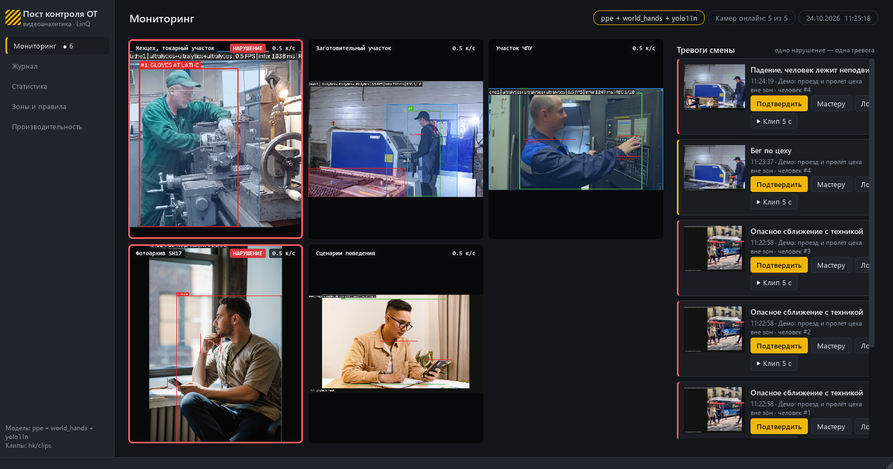

# Пост контроля ОТ — нарушения техники безопасности по видео на LinQ

**Хакатон «Открой#Моспром» 2026 · кейс LinQ** — интеллектуальный сервис контроля нарушений промышленной
безопасности по видео с камер, инференс на российских ИИ-ускорителях LinQ. Команда **«МГОКчане»**.

| Материал | Где |
|---|---|
| Код | этот репозиторий |
| Демо-видео | [`docs/demo.mp4`](docs/demo.mp4) — прогон всех сценариев через конвейер |
| Презентация | [`docs/presentation.pptx`](docs/presentation.pptx) |
| Тизер | [`TEASER.md`](TEASER.md) |
| Подробное объяснение кода | [`EXPLANATION.md`](EXPLANATION.md) |

Десктопное приложение для диспетчера и службы охраны труда. Нейросети смотрят видео с камер цеха, находят
нарушения и сразу показывают **одну** тревогу на нарушение: кадр, 5-секундный клип, камера, участок, время.
Видео пишется кусками по 5 с: куски без нарушений удаляются, с нарушениями — сохраняются вместе с местом работ.
Инференс — на ускорителе LinQ (голова YOLO на TPU в INT8, хвост на CPU), без LinQ — сам переходит на ONNX/CPU.



## Быстрый запуск (Windows, Python 3.11)

```bash
git clone https://github.com/artemagaf/safety-monitor-linq.git
cd safety-monitor-linq
pip install -r requirements.txt
python run_desktop.py
```

Откроется окно с шестью камерами: три станка (токарный, лазер, ЧПУ — стоп-кадры, «имитация стоп-кадров» из
требований кейса), демо-ролик поведенческих сценариев, кадры «огонь и груз» и веб-камера ноутбука.
Кнопка «Камеры ▾» над сеткой включает и выключает любую из них. При первом запуске скачиваются веса CLIP
(~340 МБ) для распознавания огня. Отчёты через Claude — по желанию: ключ в файле `iishka_credentials.json`
на рабочем столе (`{"api_key": "..."}`), без ключа отчёт строится по шаблону.

## Что распознаёт

| Сценарий | Как | Статус |
|---|---|---|
| Перчатки у вращающихся частей станка (запрещённое СИЗ) | YOLO11n (наша) + YOLO-World, зона станка | работает на кадрах цеха |
| Нет каски / очков / перчаток (обязательное СИЗ) | YOLO11n, обучена на Construction-PPE | работает; классы «без…» модель видит слабее |
| Вход в опасную зону | зона-полигон, рисуется мышью | работает |
| Курение | YOLO-World на вырезке головы и рук («второй взгляд») | работает на видео |
| Телефон при работе с оборудованием | YOLO11n COCO | работает на демо-ролике |
| Опасное сближение с техникой | YOLO11n COCO, зазор в ростах человека | работает на демо-ролике |
| Бег по цеху | трекер, скорость в ростах в секунду | работает на демо-ролике |
| Падение, человек лежит неподвижно | YOLO11n-pose: туловище и ноги горизонтальны + время | работает на демо-ролике |
| Открытый огонь — тревога места, и без людей | CLIP ViT-B/32 без обучения | работает на фото огня |
| Подъём груза спиной (спина наклонена, ноги прямые) | YOLO11n-pose, углы скелета | работает на фото рабочих |
| Груз закрывает обзор | YOLO-World («коробка») у головы | работает в тестах |
| Перелезание через ограждение, работа на высоте без привязи | зоны «ограждение» и «высота» | работает в тестах и на веб-камере |

Честно о границах: своих видео происшествий у нас нет — демо собрано из фото и роликов открытых датасетов;
жилет и респиратор модель знает слабо (мало данных); вес груза камера не измеряет.

| Раздел приложения | Что в нём |
|---|---|
| Мониторинг | кнопка «Камеры ▾» — включить или выключить любую камеру и видео на ходу, «⏻ Выключить» на плитке; камеры с разметкой нарушений; лента тревог: кадр, что/где/кто, кнопки «Подтвердить / Мастеру / Ложное», клип |
| Журнал | все тревоги с фильтрами по типу, камере, статусу и дате; клип по двойному щелчку; выгрузка в CSV для Excel |
| Статистика | нарушения за день, доля подтверждённых и ложных, по типам, тепловая карта «камера × час» |
| Зоны и правила | рисование зоны мышью на кадре; что в зоне обязательно и что запрещено; применяется сразу |
| Отчёты | отчёт по охране труда за период: сводку анализирует Claude (Opus 5.5), без ключа — отчёт по шаблону |
| Производительность | кадры/с и мс на кадр по каждой камере, замер скорости модели |

Тревога, отмеченная оператором как ложная, сохраняет исходный кадр в `data/retrain/` — для дообучения модели.
Камеры, зоны станков и правила — в `config.yaml`.

## Структура

```
run_desktop.py      запуск приложения
desktop/
  main_window.py    окно и разделы
  widgets.py        камера, карточка тревоги, графики, редактор зон, проигрыватель клипов
  runtime.py        запуск ядра: модель, журнал, поток на каждую камеру
  theme.py          оформление
app/
  backends.py   ← МОДЕЛЬ: единый интерфейс инференса (ultralytics / onnx / linq)
  pipeline.py     обработка камеры: кадр -> модель -> трекинг -> правила -> тревога -> клип
  tracker.py      номера людей между кадрами
  rules.py        что считается нарушением (СИЗ, зоны станков, опасные зоны)
  behavior.py     во времени: бег, падение, подъём груза спиной
  fire.py         открытый огонь (CLIP)
  events.py       сглаживание, одна тревога на нарушение, журнал (SQLite), уведомления
  segments.py     видео кусками по 5 с: чистые удаляются, с нарушением — сохраняются
  config.py       config.yaml + зоны из приложения (data/zones.json)
tools/
  prepare_dataset.py  сборка единого датасета СИЗ из нескольких
  train.py            дообучение YOLO + mAP по классам
  export.py           экспорт в ONNX для компилятора LinQ
  compile_linq.py     разрез YOLO (голова на TPU / хвост на CPU), калибровка INT8, компиляция в .tpu
  benchmark.py        скорость: мс/кадр, FPS
  compare.py          сверка LinQ с эталоном ONNX
  demo_video.py       прогон видео без интерфейса
  make_demo_video.py  сборка демо-видео docs/demo.mp4 из прогона всех сценариев
notebooks/
  linq_compile_colab.ipynb   компиляция в .tpu в Google Colab (SDK LinQ работает только на Linux)
tests/
```

## Модель

Классы: `person, helmet, no_helmet, vest, no_vest, mask, no_mask, cigarette, glasses, no_glasses, gloves, bare_hand`.

Обучена на открытом датасете [Construction-PPE](https://docs.ultralytics.com/datasets/detect/construction-ppe/)
(Ultralytics, 1416 фото: каски, жилеты, перчатки, очки и метки «без каски / без очков / без перчаток»):

```bash
python tools/prepare_dataset.py --src <construction-ppe> --out datasets/ppe
python tools/train.py --data datasets/ppe/data.yaml --model models/yolo11n.pt --epochs 40
python tools/export.py --weights models/ppe.pt
```

## Инференс на LinQ TPU

YOLO режется на две части: голова (все свёртки) идёт на TPU, лёгкий хвост (DFL, декодирование боксов) — на CPU.
Так LinQ поддерживает YOLO в своём SDK.

```bash
python tools/compile_linq.py split --onnx models/ppe.onnx      # разрез + проверка (любая ОС)
python tools/compile_linq.py compile --onnx models/ppe.onnx --calib-dir datasets/ppe/val/images   # Linux + SDK
```

Без Linux — в Google Colab: [`notebooks/linq_compile_colab.ipynb`](notebooks/linq_compile_colab.ipynb).

На стенде (VPN → Jupyter `http://hackathon.lin-q.ru/`): `ppe_head.tpu` скопировать в `/auto/cache/<ЛОГИН>/`,
в `config.yaml` указать `model.backend: linq` и путь к программе, затем:

```bash
python tools/compare.py --images datasets/ppe/val/images --ref onnx:models/ppe.onnx --test linq
python tools/benchmark.py --image data/sample.jpg --backend onnx:models/ppe.onnx --backend linq
```

Если LinQ недоступен, система сама переходит на ONNX на CPU (`linq.fallback`).

## Тесты

```bash
python -m pytest tests -q
```
